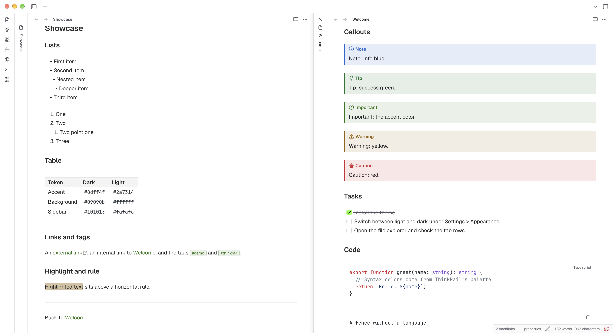
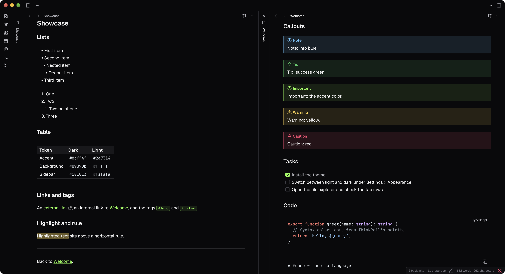

# JetBrains ThinkRail

An Obsidian theme that follows the design of [ThinkRail](https://github.com/JetBrains/thinkrail), the JetBrains IDE-style app.<sup>†</sup>





## Install

Install from the Obsidian community directory: [JetBrains ThinkRail](https://community.obsidian.md/themes/jetbrains-thinkrail).

## Releasing

Run `make release` from a clean `main` branch. The helper selects the next date-based version (`YYYY.MMDD.N`, starting at 1 each day), updates and commits `manifest.json`, creates an annotated tag without a `v` prefix, pushes `main` and the tag together, and publishes a GitHub release with the tagged `manifest.json` and `theme.css` attached. Leading zeroes in the month/day component are removed. Requires Git, Python 3 and an authenticated [GitHub CLI](https://cli.github.com/).

```sh
make release-dry-run
make release
make release ARGS="--version 2026.1118.1"
```

`--dry-run` uses local tags and does not change files or publish anything. Use `ARGS="--no-release"` to push without publishing, or `ARGS="--release-only 2026.1118.1"` to publish an existing tag using its original files. Run `./scripts/release.sh --help` for all options.

## Style Settings

Install [Style Settings](https://github.com/mgmeyers/obsidian-style-settings) plugin to configure the theme under Settings > Style Settings > JetBrains ThinkRail.

| Option | Type | Description |
| --- | --- | --- |
| Property lines | Dropdown | How the Properties block at the top of a note shows which value belongs to which name: hide lines (default), a solid or dotted line from each name to its value, or zebra striping across every other row. |
| Property line gap | Slider, 0 to 16px (default 2px) | Space on each side of the line. Applies to the solid and dotted options. |
| Velocity-style tables | Experimental toggle (off by default) | Full-width tables with muted headers, a strong header rule, vertical dividers and subtle alternating rows. Applies in Reading view and Live Preview. |
| Velocity-style lists | Experimental toggle (off by default) | Muted, rounded dashes for unordered list bullets in Reading view and Live Preview. |

The optional table and list styles are inspired by [Velocity by Floodlight](https://github.com/Gonzalo-D-Sales/obsidian-velocity), implemented with ThinkRail's colors. Enable either style independently.

## Fonts

The theme uses ThinkRail's fonts, Geist for text and JetBrains Mono for code. To keep the size of the theme small, these fonts are not included out of the box. Install them on your system and the theme will pick them up (falls back to system fonts).

- [Geist on Google Fonts](https://fonts.google.com/specimen/Geist)
- [JetBrains Mono on Google Fonts](https://fonts.google.com/specimen/JetBrains+Mono)

### Recommended
Download the whole family from each page and install it with its italics. The theme uses weights 400 (Regular), 500 (Medium) and 600 (SemiBold), so install at least those. Make sure to restart Obsidian after installing.

On macOS you can install both with Homebrew instead:

```sh
brew install --cask font-jetbrains-mono
brew install --cask font-geist
```

---

<sup>† Unofficial and not affiliated with JetBrains.</sup>
