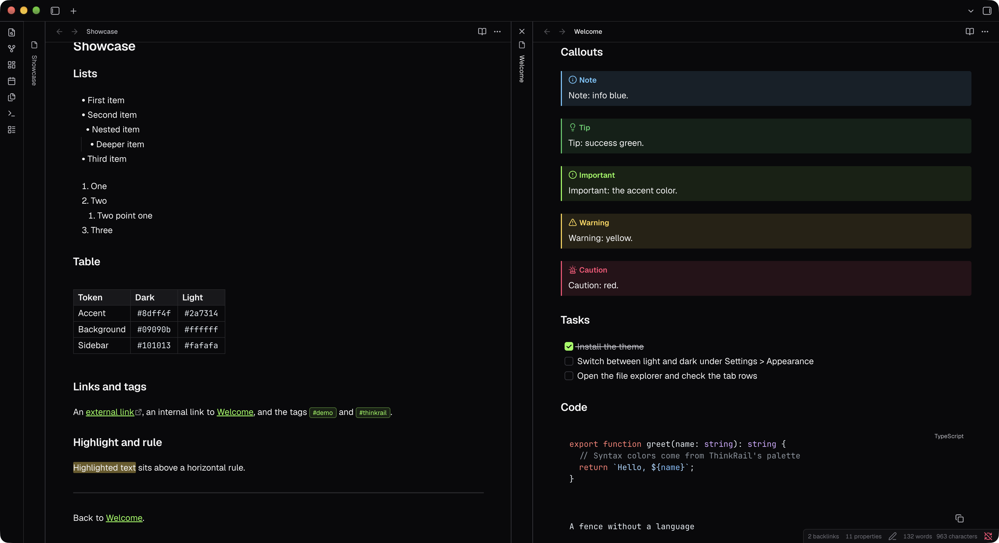
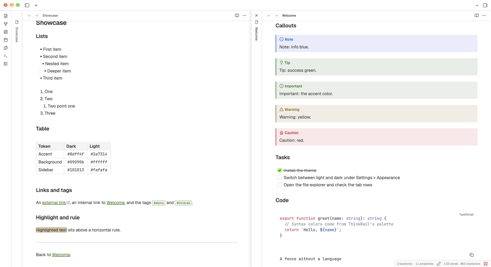

# JetBrains ThinkRail

An Obsidian theme that follows the design of [ThinkRail](https://github.com/JetBrains/thinkrail), the JetBrains IDE-style app.


> [!NOTE]
> Unofficial and not affiliated with JetBrains.





## Fonts

The theme uses ThinkRail's fonts, Geist for text and JetBrains Mono for code. It does not bundle them. Install them on your system and the theme picks them up; without them it falls back to your system fonts.

- [Geist on Google Fonts](https://fonts.google.com/specimen/Geist)
- [JetBrains Mono on Google Fonts](https://fonts.google.com/specimen/JetBrains+Mono)

> [!NOTE]
> Recommended: download the whole family from each page and install it with its italics. The theme uses weights 400 (Regular), 500 (Medium) and 600 (SemiBold), so install at least those. Restart Obsidian after installing.

On macOS you can install both with Homebrew instead:

```sh
brew install --cask font-jetbrains-mono
brew install --cask font-geist
```

### Font size

Obsidian sets the body font size itself (16px by default), which overrides a theme. To match ThinkRail's 14px body text, set Settings > Appearance > Font size to 14.

## Install

Install it from the Obsidian community directory: [JetBrains ThinkRail](https://community.obsidian.md/themes/jetbrains-thinkrail).
